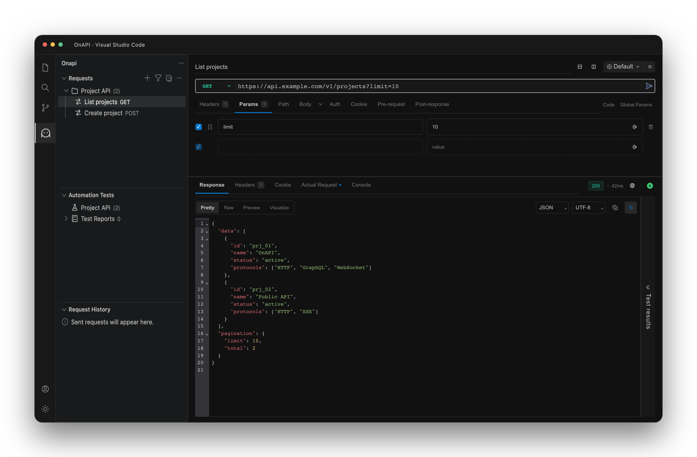

<p align="center">
  
</p>
<p align="center">
  <strong>Your APIs, inside VS Code.</strong><br />
  Send requests, explore real-time connections, and test APIs without leaving your editor.
</p>
<p align="center">
  <a href="#getting-started">Getting started</a> ·
  <a href="#features">Features</a> ·
  <a href="#development">Development</a> ·
  <a href="https://github.com/hazicy/onapi-vscode/issues">Feedback</a>
</p>

> [!IMPORTANT]
> **Work in progress** — OnAPI is under active development and is not yet a stable release. Features, interfaces, and storage formats may change. Bug reports and feedback are welcome.

<p align="center">
  
</p>

## Features

OnAPI is a lightweight API client for Visual Studio Code. Organize requests in local collections and use environment variables without signing in.

| Capability                 | What you can do                                                                             |
| -------------------------- | ------------------------------------------------------------------------------------------- |
| HTTP & GraphQL             | Configure query parameters, headers, authentication, and request bodies; inspect responses. |
| Real-time connections      | Work with WebSocket, Socket.IO, and Server-Sent Events (SSE).                               |
| Collections & environments | Group saved requests and switch variables between environments.                             |
| Scripts & tests            | Use Postman-compatible scripts, run collections, and check assertions.                      |
| Import & export            | Bring in existing collections and export requests for reuse.                                |
| API documentation          | Share saved HTTP and GraphQL requests through the local documentation service.              |
| Editor integration         | Use a compact interface that follows your VS Code theme.                                    |

## Getting started

OnAPI requires **VS Code 1.101 or newer**.

1. Build a `.vsix` from source using the instructions below.
2. In VS Code, open **Extensions → … → Install from VSIX…** and select the package from `artifacts/`.
3. Open **onapi** in the activity bar, create a collection, and add your first request.
4. Configure the URL, parameters, headers, or body, then send the request to inspect its response.

### Share API documentation

Right-click a saved HTTP or GraphQL request in the OnAPI sidebar and select **Share API Documentation**. The documentation link is copied to your clipboard; select **Open Documentation** in the notification to preview it.

Use **Shared API Documents** in the Requests view menu to copy, open, or remove shares. Links are served by the local documentation service and remain available while VS Code is running.

## Development

Use **Node.js 22.19+** and **pnpm 12.10.1**, as pinned in `package.json`.

```sh
git clone https://github.com/hazicy/onapi-vscode.git
cd onapi-vscode
pnpm install --frozen-lockfile
pnpm dev
```

For debugging, open the workspace in VS Code and press **F5** to launch an Extension Development Host.

### Build and package

```sh
pnpm build
pnpm package
```

The installable `.vsix` is written to `artifacts/`.

### Checks

| Command             | Purpose                                              |
| ------------------- | ---------------------------------------------------- |
| `pnpm check`        | Run lint, workspace boundary checks, and unit tests. |
| `pnpm typecheck`    | Check types across all workspaces.                   |
| `pnpm format:check` | Check formatting with Oxfmt.                         |
| `pnpm test:ui`      | Run browser UI tests.                                |
| `pnpm test:editor`  | Run editor regression tests.                         |

See the [development guide](./scripts/README.md) for hot reload, localization, browser test setup, and additional commands.

### Workspace layout

| Directory        | Responsibility                                                      |
| ---------------- | ------------------------------------------------------------------- |
| `apps/extension` | VS Code extension host and native sidebar.                          |
| `apps/webviews`  | Request editors and browser UI.                                     |
| `packages`       | Shared contracts, API conversion, domain models, core, and runtime. |
| `scripts`        | Development, builds, packaging, and validation.                     |

See [workspace architecture](./docs/monorepo.md) for package boundaries and feature ownership.

## Brand assets

The Continuous symbol appears above and is used for the activity bar and extension icon.

[App icon](./apps/webviews/public/images/onapi-icon.svg) · [Activity bar icon](./apps/webviews/public/images/onapi-activity.svg)

SVG sources and matching light/dark tree icons live in `apps/webviews/public/images`. Regenerate PNG assets with:

```sh
node scripts/generate-brand-icons.mjs
```

## Feedback & license

Have a bug report or feature request? [Open an issue](https://github.com/hazicy/onapi-vscode/issues).

Licensed under the [MIT License](./LICENSE.txt). Original copyright notices are retained in the applicable license files.
