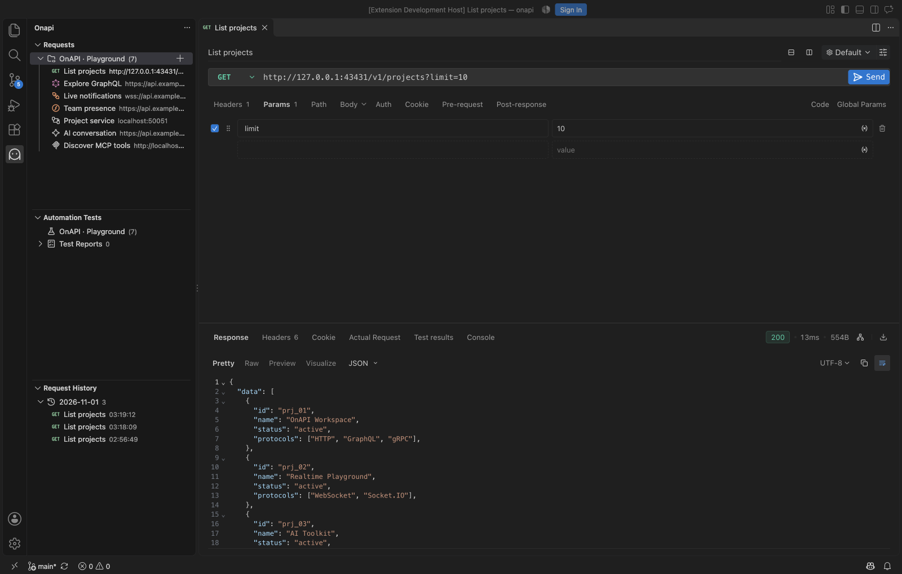
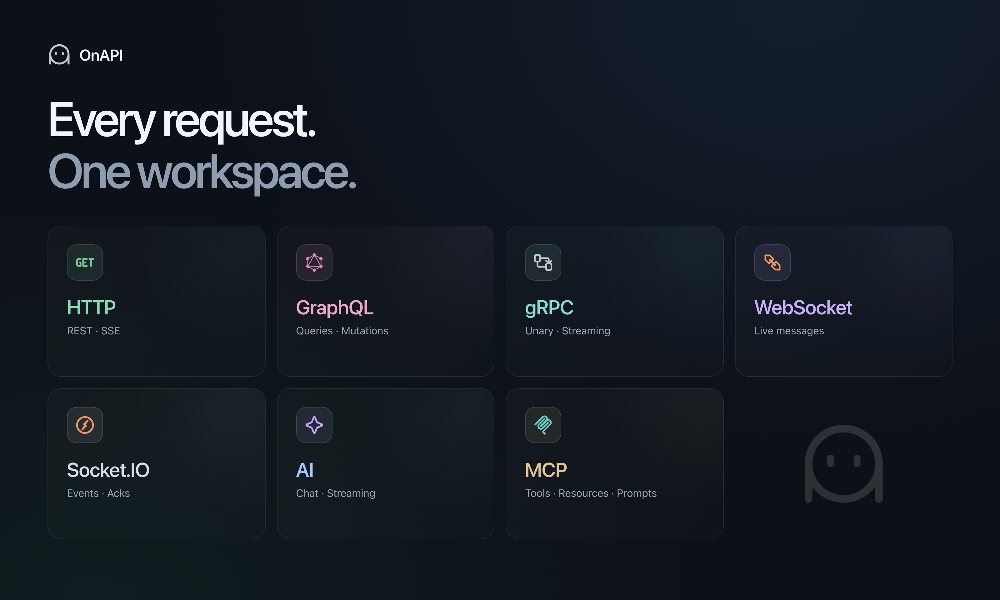

<p align="center">
  
</p>
<p align="center">
  <strong>Your APIs, inside VS Code.</strong><br />
  HTTP, GraphQL, real-time connections, gRPC, AI, and MCP — in one local workspace.
</p>
<p align="center">
  <a href="#getting-started">Getting started</a> ·
  <a href="#supported-protocols">Protocols</a> ·
  <a href="#features">Features</a> ·
  <a href="#development">Development</a> ·
  <a href="https://github.com/hazicy/onapi-vscode/issues">Feedback</a>
</p>

> [!IMPORTANT]
> **Work in progress** — OnAPI is under active development and is not yet a stable release. Features, interfaces, and storage formats may change. Bug reports and feedback are welcome.

<p align="center">
  
</p>

<p align="center"><sub>OnAPI in VS Code: seven request types, a local demo API, and a real JSON response.</sub></p>

## Supported protocols

<p align="center">
  
</p>

| Request type | Supported workflow                                                                                             |
| ------------ | -------------------------------------------------------------------------------------------------------------- |
| HTTP         | REST requests, authentication, headers, cookies, bodies, scripts, assertions, and SSE response streams.        |
| GraphQL      | Queries and mutations, variables, schema exploration, and response inspection.                                 |
| WebSocket    | Persistent connections with a sent/received message timeline.                                                  |
| Socket.IO    | Event subscriptions, messages, acknowledgements, and subscription changes.                                     |
| gRPC         | Server reflection or `.proto` imports; unary, server streaming, client streaming, and bidirectional streaming. |
| AI           | OpenAI-compatible chat completions, streaming conversations, cancellation, and token usage.                    |
| MCP          | Streamable HTTP, SSE, and stdio transports; tool calls, resources, and prompts.                                |

SSE is supported as an HTTP response stream and an MCP transport. It uses those editors rather than a separate request type. See the [gRPC](#grpc-requests) and [AI/MCP](#ai-and-mcp-requests) guides below for setup and current limitations.

## Features

OnAPI is a lightweight API client for Visual Studio Code. Organize requests in local collections and use environment variables without signing in.

| Capability                 | What you can do                                                                |
| -------------------------- | ------------------------------------------------------------------------------ |
| Collections & environments | Group saved requests and switch variables between environments.                |
| Scripts & tests            | Use Postman-compatible scripts, run collections, and check assertions.         |
| Import & export            | Bring in existing collections and export requests for reuse.                   |
| API documentation          | Share saved HTTP and GraphQL requests through the local documentation service. |
| Editor integration         | Use a compact interface that follows your VS Code theme.                       |

## Getting started

OnAPI requires **VS Code 1.101 or newer**.

1. Build a `.vsix` from source using the instructions below.
2. In VS Code, open **Extensions → … → Install from VSIX…** and select the package from `artifacts/`.
3. Open **onapi** in the activity bar, create a collection, and add your first request.
4. Configure the URL, parameters, headers, or body, then send the request to inspect its response.

### gRPC requests

Select **New → gRPC** in the sidebar. Enter a server address such as `localhost:50051`, then open **Service definition**. Use **Server reflection → Load services**, or import a `.proto` file/folder and load its services. Local imports are bundled with the saved request; reflection supports both v1 and v1alpha. Saved service definitions reopen from their source snapshot, and parsed schemas are reused through a bounded cache. You can also edit proto sources directly.

Select a method, open **Message**, and use **Use example message** to generate a payload. Configure **Metadata**, **Authorization**, and **Settings** as needed, then select **Invoke**. Unary, server streaming, client streaming, and bidirectional streaming calls share a sent/received message timeline. For client streams, the initial message is sent when invoking; use **Send message** for additional messages and **End streaming** to finish sending while still receiving the server response. **Cancel** closes the call.

Responses include gRPC status codes, elapsed time, response metadata, and trailers. Settings include deadlines (0 means no call deadline), response size limits, default fields, custom root CAs, server name override, and client certificate/key pairs for mutual TLS. `grpcs://` and `https://` endpoints enable TLS; bare addresses use the TLS toggle. Collection/environment variables are resolved before execution. Native save, undo, redo, and revert preserve message text and service definitions, including unfinished JSON/proto edits.

The editor follows Postman's gRPC request workflow. gRPC scripts, OAuth flows, and grpcurl import/export are not implemented. gRPC uses its HTTP/2 transport; application HTTP proxy settings are currently only shared by HTTP, socket, AI, and MCP paths.

See [execution architecture](docs/architecture/execution.md) for resource ownership, execution context, and service-definition caching.

### AI and MCP requests

In the sidebar's **New** menu, select **AI** or **MCP**. Both request types can be named, organized in folders, saved, and reopened.

For AI, enter an OpenAI-compatible base URL (including `/v1` where required), a model ID, and an API key under **Settings**. Configure the system prompt, temperature, and output token limit, then send messages in **Chat**. Responses stream into the conversation; **Stop** cancels the current request. Saving preserves the conversation and configuration. The dedicated API key field stays in memory for the current panel.

For MCP, choose **Streamable HTTP**, **SSE**, or **stdio** under **Settings**. Enter the server URL or the local command and JSON argument array, then select **Connect**. Send `tools/list`, `resources/list`, or `prompts/list` to discover capabilities. Select a returned entry to prepare a tool call, resource read, or prompt retrieval; supply JSON arguments and send. The response panel displays the complete server result and tool input schemas. Use **Load more** when a server returns another page. Closing the editor closes its connections and cancels active AI requests. Custom headers entered in **Headers** are saved with the request. Incomplete JSON inputs remain part of the native document draft, including save, undo, and revert. AI and MCP resolve collection and environment variables at execution time, reuse the application proxy policy, and record requests in history.

These editors follow Postman's request, settings, and response workflow. AI currently uses OpenAI-compatible chat completions; MCP authentication uses custom headers. OAuth flows, sampling handlers, and automatic AI-to-MCP tool orchestration are not implemented.

### Share API documentation

Right-click a saved HTTP or GraphQL request in the OnAPI sidebar and select **Share API Documentation**. The documentation link is copied to your clipboard; select **Open Documentation** in the notification to preview it.

Use **Shared API Documents** in the Requests view menu to copy, open, or remove shares. Links are served by the local documentation service and remain available while VS Code is running.

## Development

Use **Node.js 22.19+** and **pnpm 12.10.1**, as pinned in `package.json`.

```sh
git clone https://github.com/hazicy/onapi-vscode.git
cd onapi-vscode
pnpm install --frozen-lockfile
pnpm dev
```

For debugging, open the workspace in VS Code and press **F5** to launch an Extension Development Host.

### Build and package

```sh
pnpm build
pnpm package
```

The installable `.vsix` is written to `artifacts/`.

### Checks

| Command             | Purpose                                              |
| ------------------- | ---------------------------------------------------- |
| `pnpm check`        | Run lint, workspace boundary checks, and unit tests. |
| `pnpm typecheck`    | Check types across all workspaces.                   |
| `pnpm format:check` | Check formatting with Oxfmt.                         |
| `pnpm test:ui`      | Run browser UI tests.                                |
| `pnpm test:editor`  | Run editor regression tests.                         |

See the [development guide](./scripts/README.md) for hot reload, localization, browser test setup, and additional commands.

### Workspace layout

| Directory        | Responsibility                                                      |
| ---------------- | ------------------------------------------------------------------- |
| `apps/extension` | VS Code extension host and native sidebar.                          |
| `apps/webviews`  | Request editors and browser UI.                                     |
| `packages`       | Shared contracts, API conversion, domain models, core, and runtime. |
| `scripts`        | Development, builds, packaging, and validation.                     |

See [workspace architecture](./docs/monorepo.md) for package boundaries and feature ownership.

## Brand assets

The Continuous symbol appears above and is used for the activity bar and extension icon.

[App icon](./apps/webviews/public/images/onapi-icon.svg) · [Activity bar icon](./apps/webviews/public/images/onapi-activity.svg)

SVG sources and matching light/dark tree icons live in `apps/webviews/public/images`. Regenerate PNG assets with:

```sh
node scripts/generate-brand-icons.mjs
```

## Feedback & license

Have a bug report or feature request? [Open an issue](https://github.com/hazicy/onapi-vscode/issues).

Licensed under the [MIT License](./LICENSE.txt). Original copyright notices are retained in the applicable license files.
